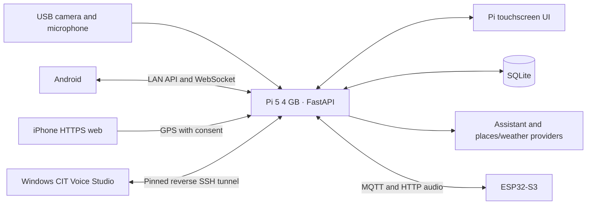
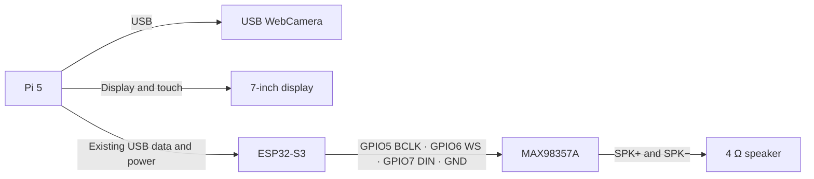
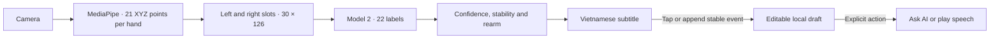
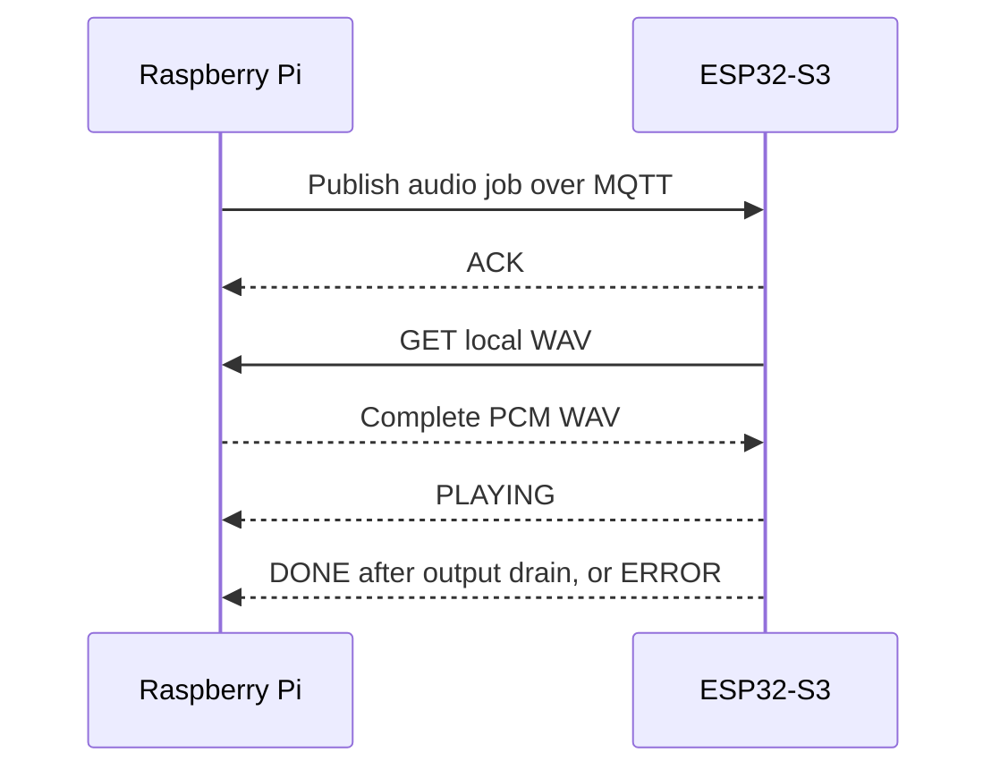
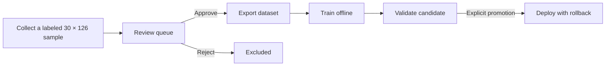
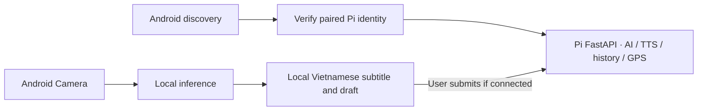

# Deafy engineering diagrams

### System architecture

### Verified wiring

VIN, MAX9814 and exact display connectors require inspection before documenting them as verified. This drawing does not direct rewiring.

### Gesture and draft pipeline

### Pi ↔ ESP32-S3

### TTS and playback

### Learning and controlled retraining

### Android and Pi

